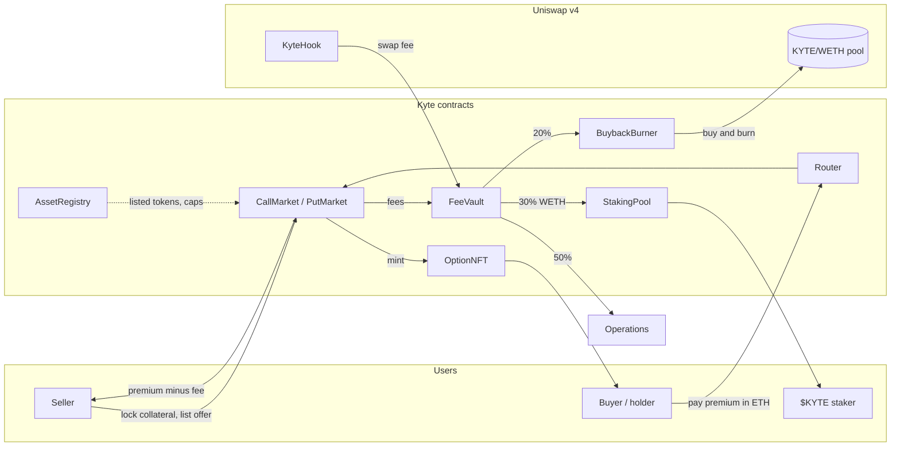

# Kyte documentation

Kyte is a non-custodial, fully collateralised options market on Robinhood Chain. These pages explain how it works,
what it costs, what can go wrong, and where the contracts are. The same content is at [kyte.sh/docs](https://kyte.sh/docs).

| Page | |
|---|---|
| [How it works](how-it-works.md) | Covered calls, cash-secured puts, the Option NFT, settlement |
| [Selling an option](selling.md) | Listing an offer step by step |
| [Buying and exercising](buying.md) | Filling, holding, exercising, expiry |
| [Fees](fees.md) | The two fees and their hard caps |
| [Fee split and staking](staking.md) | 30 / 20 / 50, epochs, staking rules |
| [Uniswap v4](uniswap-v4.md) | Buyback, the hook, the price feed |
| [Rules and limits](rules.md) | Expiry window, caps, pause semantics |
| [Risks](risks.md) | Read before trading |
| [Contracts](contracts.md) | Live addresses and listed markets |
| [Glossary](glossary.md) | Terms |

## The whole system on one page

Options can expire worthless. Nothing here is investment advice. Kyte is built on Robinhood Chain and is not
affiliated with or endorsed by Robinhood.
