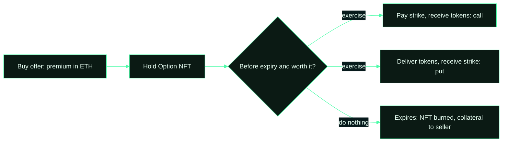

# Buying and exercising

1. **Buy from the Market page.** Pay the premium in ETH through the Router, which wraps it for you. You receive the
   Option NFT; the seller receives the premium.
2. **Hold, transfer or sell the NFT.** The position belongs to whoever holds the NFT. Transfer it like any ERC-721;
   the new holder gets the exercise right.
3. **Exercise before expiry.** Calls: pay the strike in ETH via `exerciseWithETH` and receive the tokens. Puts:
   approve the tokens and call `exercisePut` to receive the strike. A 0.1% fee on the strike applies.
4. **Or let it expire.** If you do nothing, the option expires worthless, the collateral returns to the seller and
   the NFT is burned.

Exercise early, not at the last block. Robinhood Chain has a single sequencer. A transaction that lands after the
expiry timestamp fails, and the position is then expirable by anyone. Leave yourself a margin.

