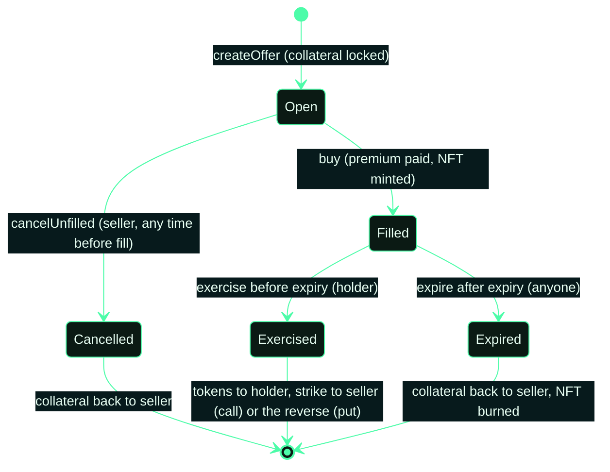

# How it works

Every option on Kyte is backed by the full collateral from the moment the offer is listed. There is no margin, no
leverage and no liquidation. Settlement is physical: tokens and ETH change hands, nothing is cash-settled against a
price feed.

## Covered call

A seller locks tokens and sets three things: a strike price in ETH, an expiry, and the premium they want. A buyer pays
the premium and receives the Option NFT. Until expiry, the holder can pay the strike and take the tokens. If nobody
exercises, the tokens go back to the seller after expiry.

## Cash-secured put

The mirror image. The seller locks ETH (held as WETH) equal to the strike. The holder can deliver the tokens before
expiry and receive that ETH. If the option expires unused, the ETH returns to the seller.

## Options are NFTs

A filled offer mints one ERC-721 to the buyer. Whoever holds it at exercise time gets the payout, so positions can be
transferred or sold on. Exercise burns the NFT.

## No oracle, no auto-exercise

Kyte never reads a price. The holder decides whether exercising is worth it and sends the transaction. An option that
is in the money but never exercised simply expires.

## Lifecycle

Status only moves forward. An option can never be both exercised and expired.
