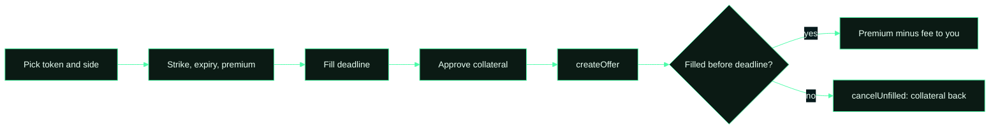

# Selling an option

1. **Pick the token and the side.** Covered call if you hold the token, cash-secured put if you hold ETH. Only tokens
   listed in the AssetRegistry can be used.
2. **Set strike, expiry and premium.** Expiry must be between 1 hour and 90 days away. The premium must be at least
   0.0005 ETH. The Sell page shows a Black-Scholes hint for the premium; it is display only, the contracts never read a
   price.
3. **Choose a fill deadline.** How long the offer stays open for buyers. It cannot be later than expiry. If it passes
   unfilled, you can reclaim your collateral at any time.
4. **Approve and list.** One approval for the token (calls) or WETH (puts), then `createOffer`. Your collateral moves
   into the market contract and the offer appears on the Market page.
5. **Get paid when it fills.** The premium, minus the 3% fee, is sent to you the moment a buyer fills. From then on
   the position runs to exercise or expiry.

Cancelling is free: an unfilled offer can be cancelled at any time with `cancelUnfilled`. Only gas is paid; no fee is
charged until a buyer actually fills.

