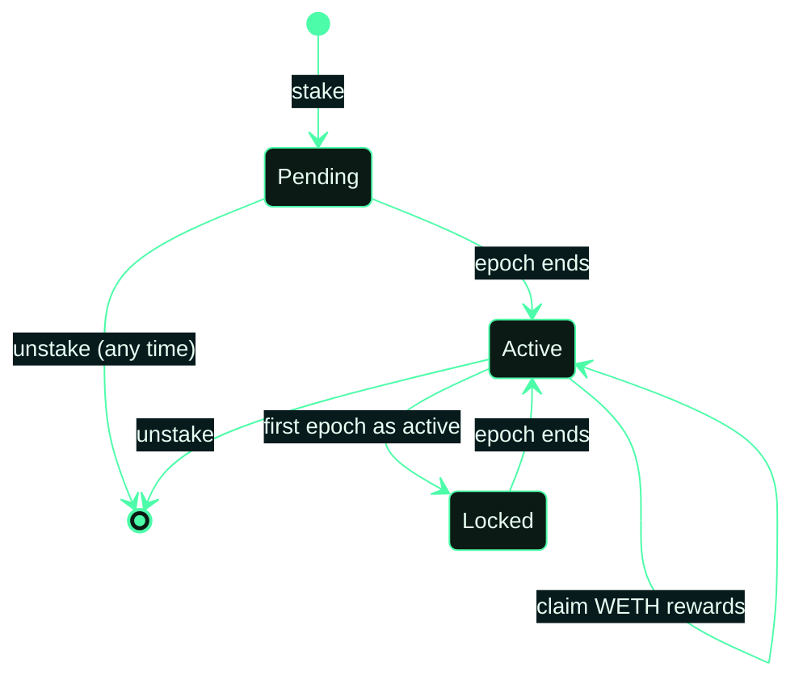
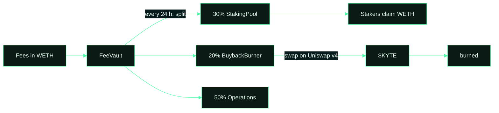

# Fee split and staking

The FeeVault gathers every fee in WETH and splits it once per epoch (24 hours). Each split is an on-chain `FeesSplit`
event, and each buyback ends in a `Burned` event. The Proof page lists both.

| Share | Goes to |
|---|---|
| 30% | $KYTE stakers, paid in WETH |
| 20% | Buy $KYTE on Uniswap v4 and burn it |
| 50% | Operations |

Stakers always receive at least 20%: the contracts refuse a split that goes below it.

## Staking rules

- Stake $KYTE any time. New stake is **pending** until the current epoch ends, then becomes **active**.
- Active stake earns its share of the epoch's fees, claimable any time with `claim`.
- Stake that just became active is locked for one full epoch. Pending stake can be unstaked at any time, so a mistaken
  stake can be reversed before the epoch ends.
- Stake, unstake and claim are free apart from gas.

