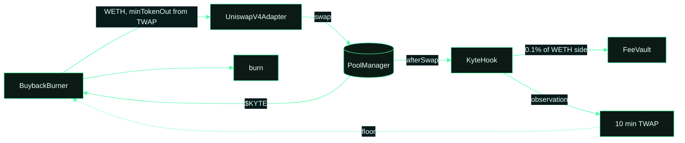

# Uniswap v4 inside Kyte

Kyte does not run its own exchange. Three parts of the protocol sit directly on Uniswap v4 on Robinhood Chain.

**Buyback and burn.** Every epoch, 20% of fees are swapped for $KYTE straight on the v4 PoolManager and burned in the
same transaction. The slippage bound is checked against the hook's TWAP, with a per-call cap on size.

**KyteHook.** Records a price observation after every swap and exposes a 10-minute TWAP that a single block cannot
move. The same hook takes 0.1% of the WETH side of each swap in the $KYTE/WETH pool and sends it to the FeeVault,
where it joins the normal split.

**Price feed for the charts.** The Market and Sell charts are built from v4 `Swap` events on each listed token's WETH
pool, plus Robinhood market quotes for stock tokens. Nothing is quoted from a private API.

A v4 hook's permissions are encoded in its address, so KyteHook is deployed at a CREATE2 address with the
`afterInitialize`, `afterSwap` and `afterSwapReturnDelta` bits set.

